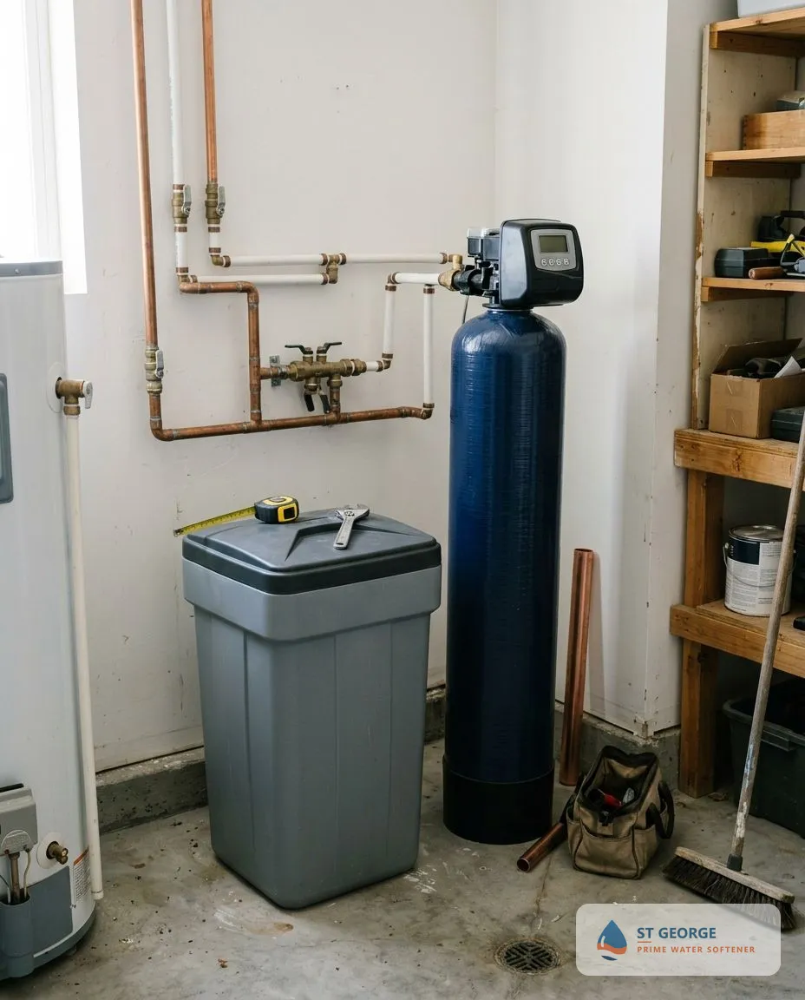

## How Does Water Softener Installation Work in St George, UT?

Water softener installation follows four steps from the first call to a tested result.

### Step 1: Free Consultation

We talk through your household size, water use and what you notice at the tap, then book a visit at a time that suits you.

### Step 2: Water Testing & System Recommendation

A technician tests your water, measures hardness and recommends a softener size and type, with a written, itemized price.

### Step 3: Professional Installation

A qualified technician installs the system, connects the drain and brine line, programs the control head and tests every tap. A standard install typically takes about 2 to 4 hours.

### Step 4: Ongoing Support & Maintenance

We explain salt refills and settings, check the system at follow-up visits and answer questions after the job is done.

## Frequently Asked Questions About Water Softeners in St George, UT

Most questions homeowners ask before buying fall into eight areas: water hardness, cost, system choice, timeline, water source, upkeep, permits and where we work.

How hard is St George water?

The City of St. George advises softener settings of 13 to 24 GPG (about 222 to 410 mg/L), which is Very Hard on the Water Quality Association scale <mark class="data-gap">[VERIFY: the City's reports give a softener-setting range, not a measured hardness]</mark>. Most homes benefit from a softener, and a free test shows your exact number.

How much does water softener installation cost in St George, UT?

Cost depends on system size, type and the plumbing in your home. <mark class="data-gap">[NEEDS DATA: installed price range, from the tenant or a sourced Utah report.]</mark> Your free estimate itemizes equipment, installation and any extra plumbing before you approve it.

What is the best water softener for St George water?

A salt-based softener sized to your hardness reading gives the strongest result in water above 180 mg/L. St George water calls for softener settings of 13 to 24 GPG, so the best unit depends on your measured reading and your household size, and many homes want softening plus whole-home filtration. <mark class="data-gap">[NEEDS DATA: SpringWell affiliate link, salt-based softener recommendation.]</mark> *Disclosure: if you buy through a SpringWell link on this site, the site may earn a commission at no extra cost to you.*

Salt vs. salt-free water softener: what is the difference?

A salt-based softener removes calcium and magnesium by ion exchange and leaves soft water. A salt-free conditioner changes how scale forms but leaves the minerals in the water. Choose salt-based for the strongest result in very hard water, and salt-free if you want no salt or brine drain and accept a milder effect.

How long does water softener installation take?

A standard installation typically takes about 2 to 4 hours. Plumbing access, drain location and system type can lengthen the visit, and the technician confirms the schedule at your estimate.

Do I need a water softener with city water or well water in St George?

Yes, in both cases, because hardness appears in the City's surface water and groundwater and in private wells. Private wells need a water test first for iron and sulfur, which affect the softener.

Does a water softener installation need a permit in St George?

Permit rules depend on the jurisdiction, which may be the City of St. George or Washington County. <mark class="data-gap">[NEEDS DATA: confirm the permit rule for your address with the permitting office, and the Utah licence rule with the Utah Division of Professional Licensing.]</mark> Your installer should state who pulls the permit before work starts.

How often does a water softener need maintenance?

Check the salt level monthly and refill it when the tank is below one third full. A technician should inspect the system once a year, clean the brine tank when salt bridges form and check the control head and resin.

What areas do you serve?

We serve St George and the surrounding Washington County communities. <mark class="data-gap">[NEEDS DATA: confirm the tenant's service area list.]</mark> Nearby cities such as Washington City, Santa Clara, Ivins and Hurricane have their own water systems, and a free test confirms the hardness at your address. Call to confirm your address.

## Where Do You Install Water Softeners Around St George, UT?

We install, repair and replace water softeners across St George and the surrounding communities, including Bloomington, Bloomington Hills, Green Valley, Sun River and Little Valley. <mark class="data-gap">[NEEDS DATA: confirm the tenant's service area list before naming more places.]</mark> System size depends on your household size and the reading at your tap.
