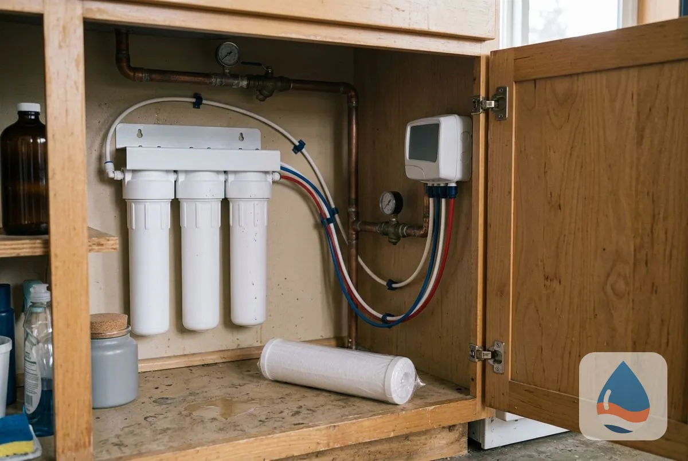
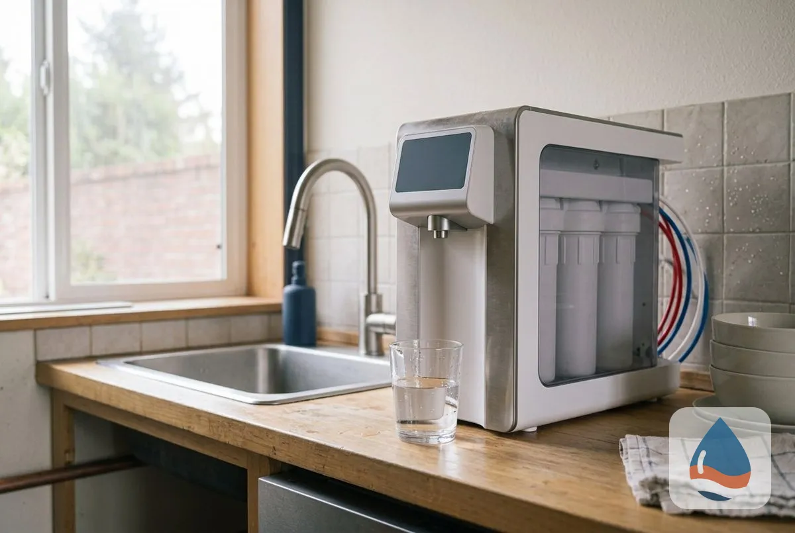
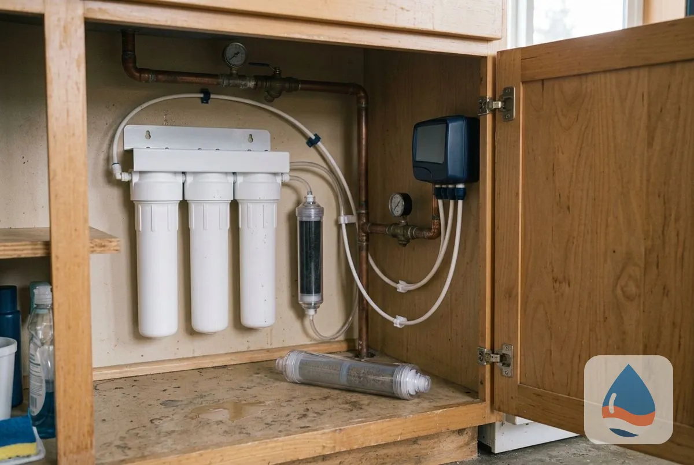

## What Types of Drinking Water Systems Can You Install in St George, UT?

Three drinking water systems cover most homes: under sink systems, countertop purification units and alkaline water systems.

### Under Sink Drinking Water Systems

An under-sink drinking water system filters the water at one kitchen tap, from a simple carbon filter to full [reverse osmosis](/reverse-osmosis-installation/). It is out of sight and delivers filtered water on demand.

### Countertop Purification Units

A countertop purification unit sits beside the sink and connects to the faucet or holds its own tank. It needs no plumbing changes, which suits renters and small kitchens.

### Alkaline Water Systems

An alkaline system adds a stage that raises the water's pH after [filtration](/water-filtration-systems/). The technician explains what the added stage does and does not do before you decide. <mark class="data-gap">[VERIFY: cite a source for any health claim; none is made here.]</mark>

### Bottleless Water Cooler Installation

A bottleless cooler connects to your water line and filters the water it serves, with hot and cold taps. It suits offices and busy households that go through a lot of bottled water.

> **Not a good fit if...** your main concern is hard water scale. A drinking water system treats one tap, and a [softener](/water-softener-systems/) treats the house.

## Which drinking water system fits your tap?

Your taste preference, budget and test result decide. A [free water test](/water-quality-testing/) and a short conversation settle it.

Homeowners comparing options also read about [UV water purification](/uv-water-purification/), [the hard water guide](/water-softener-guides/hard-water-st-george-ut/) and [water contaminant removal](/water-contaminant-removal-st-george-ut/).

## Frequently Asked Questions

Is a drinking water system worth it with city water?

It improves taste and lowers what your test finds. <mark class="data-gap">[NEEDS DATA: the provider's compliance statement from its current report.]</mark> The choice is about taste and preference.

Under-sink or countertop?

Under-sink is out of sight and delivers on demand. Countertop needs no plumbing and is easy to move.

How often do filters need replacing?

On the maker's schedule, which depends on the system and your water use. The technician sets it at installation.

Does a drinking water system soften water?

No. Softening needs a water softener. The two work together.

[St George Prime Water Softener UT](/) provides drinking water system installation for homes and businesses across St George and Washington County.

## Get Your Free Estimate

Request a free drinking water system estimate. We will contact you within 24 hours. [Get a Free Estimate](#estimate) or return to St George Prime Water Softener for every service we offer. For all treatment options, see [Water Treatment Services in St George, UT](/water-treatment-and-testing/).
