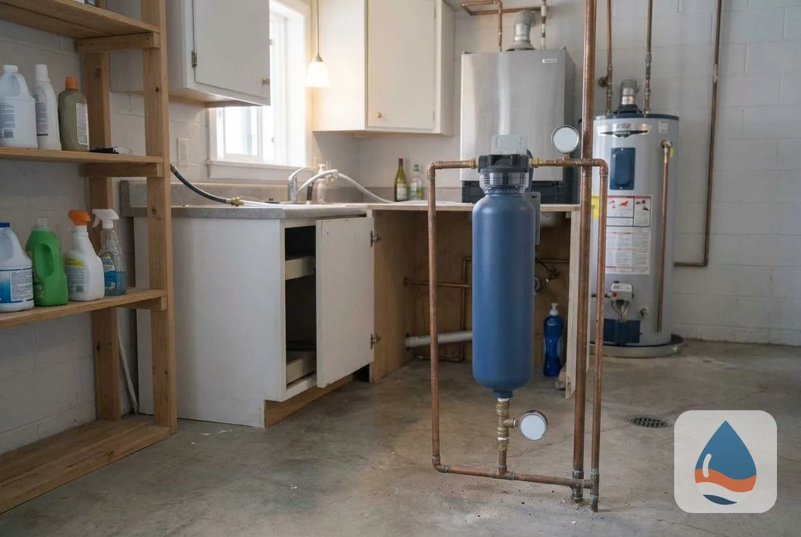
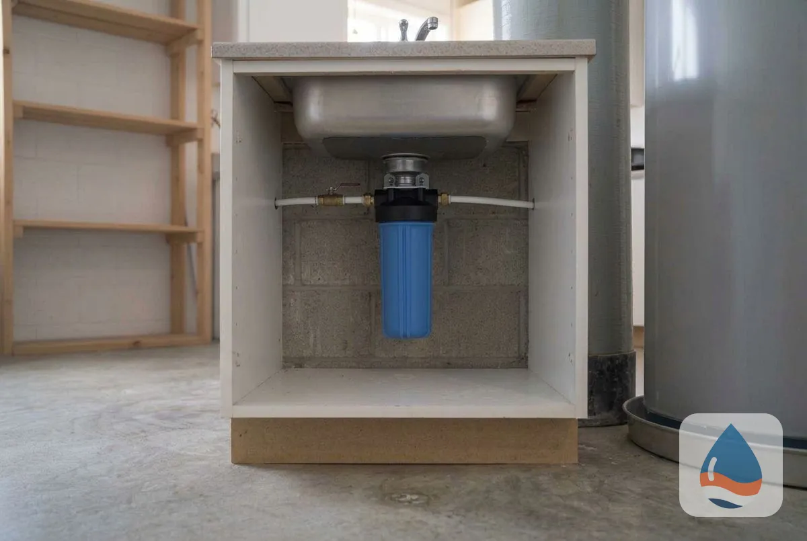
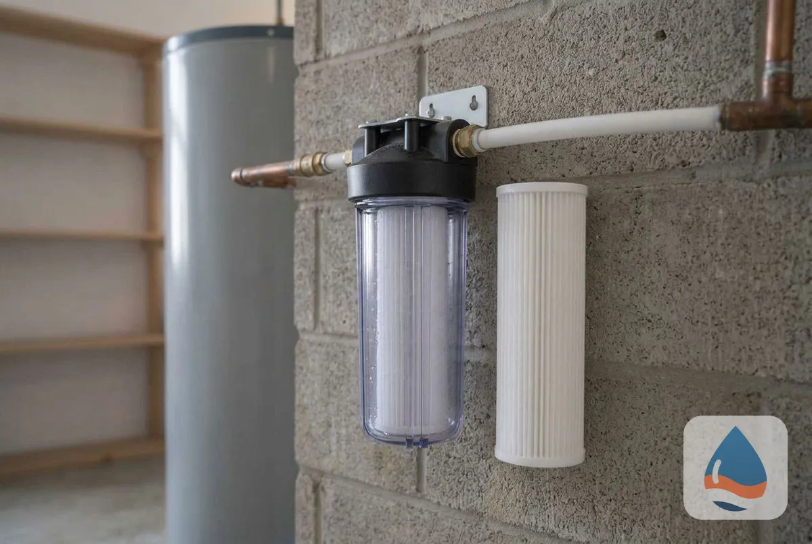
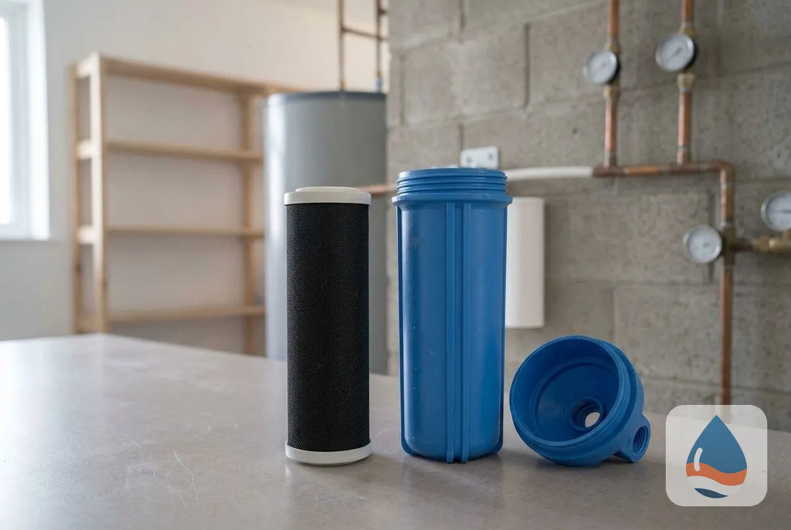
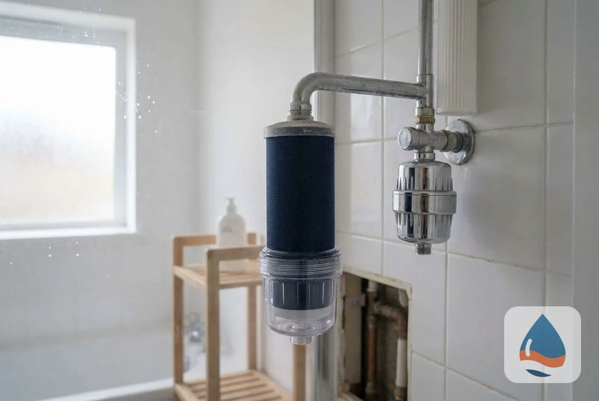
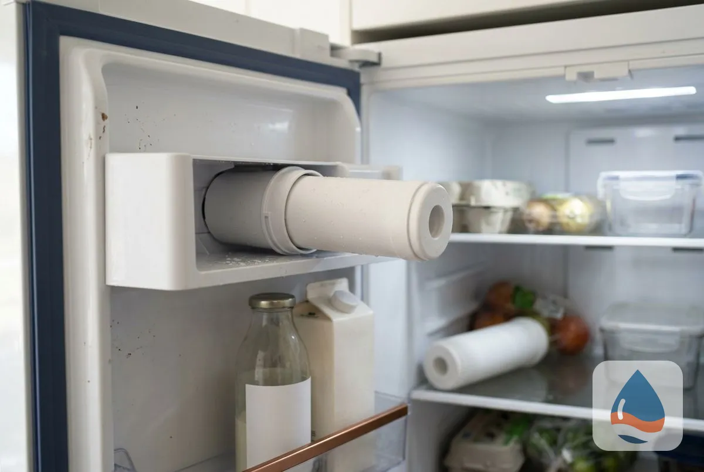

## What Types of Water Filtration Systems Do St George Homes Use?

Seven filtration options cover the whole house, the sink, the shower and the refrigerator: whole house filters, under sink filters, sediment filters, carbon block filters, shower filters, refrigerator filter replacement and multi-stage filtration.

### Whole House Water Filter

A whole-house filter treats water where it enters the home, so every tap, shower and appliance receives filtered water. A sediment stage catches particles and a carbon stage reduces chlorine taste and odor. It does not remove hardness minerals, so it pairs with a [softener](/water-softener-installation/) where water is hard.

### Under Sink Water Filter

An under-sink filter sits in the cabinet and filters the water at one faucet, typically the kitchen tap used for drinking and cooking. It is easy to install and the cartridge is replaced on a schedule set by the maker.

### Sediment Filter Installation

A sediment filter traps sand, rust and silt before they reach fixtures and softeners. It is often the first stage in a whole-house system and protects resin from clogging. The technician picks a micron rating from your water test.

### Carbon Block Filter

A carbon block filter uses dense carbon to reduce chlorine, taste, odor and some organic chemicals. It suits [drinking water](/drinking-water-systems/) and ahead of a [reverse osmosis](/reverse-osmosis-installation/) membrane.

### Shower Filter Installation

A shower filter screws onto the shower arm and reduces chlorine at the point of use. It is a low-cost option for skin and hair comfort, with a cartridge replaced on a schedule.

### Refrigerator Filter Replacement

A refrigerator filter treats the water and ice from the fridge. Replacing it on the maker's schedule keeps taste and flow steady.

### Multi-Stage Filtration

A multi-stage system stacks sediment, carbon and other media in one setup. It suits homes with more than one concern, such as sediment, chlorine taste and specific [contaminants](/water-contaminant-removal-st-george-ut/).

> **Not a good fit if...** your main concern is hard water scale. A filter does not remove hardness, and a softener does.

## Which filter matches your water?

Your test result decides: sediment points to a sediment filter, taste and odor to carbon and specific contaminants to a certified filter. A [free water test](/water-quality-testing/) sets the plan.

Homeowners comparing options also read about [UV water purification](/uv-water-purification/) and [the hard water guide](/water-softener-guides/hard-water-st-george-ut/).

## Frequently Asked Questions

Do I need a filter if I have a water softener?

Often yes. A softener removes hardness, and a filter removes sediment, chlorine taste and odor. They solve different problems.

How often do I replace filter cartridges?

It depends on the filter and your water use. The technician sets a schedule at installation, following the maker's rating.

What does a whole-house filter remove?

It removes particles and reduces chlorine taste and odor. For specific contaminants, a certified filter chosen from your test is needed.

What does filtration cost in St George?

<mark class="data-gap">[NEEDS DATA: installed price range from the tenant or a sourced Utah report.]</mark> The estimate is free and itemized.

[St George Prime Water Softener UT](/) provides water filtration system installation for homes and businesses across St George and Washington County.

## Get Your Free Estimate

Request a free water filtration estimate. We will contact you within 24 hours. [Get a Free Estimate](#estimate) or return to St George Prime Water Softener for every service we offer. For all treatment options, see [Water Treatment Services in St George, UT](/water-treatment-and-testing/).
