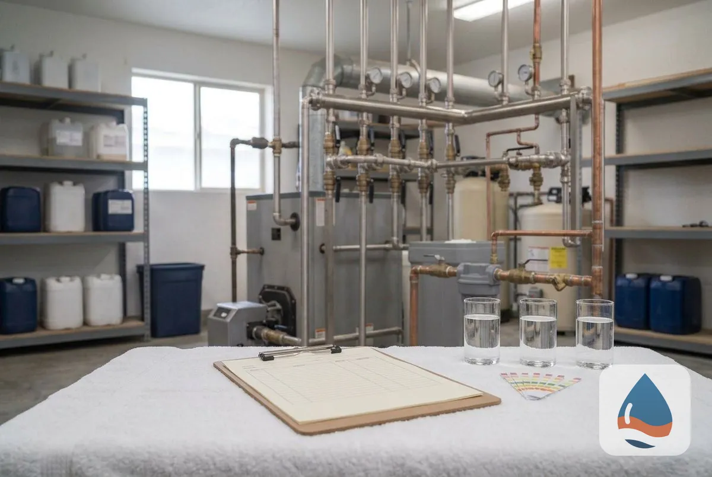
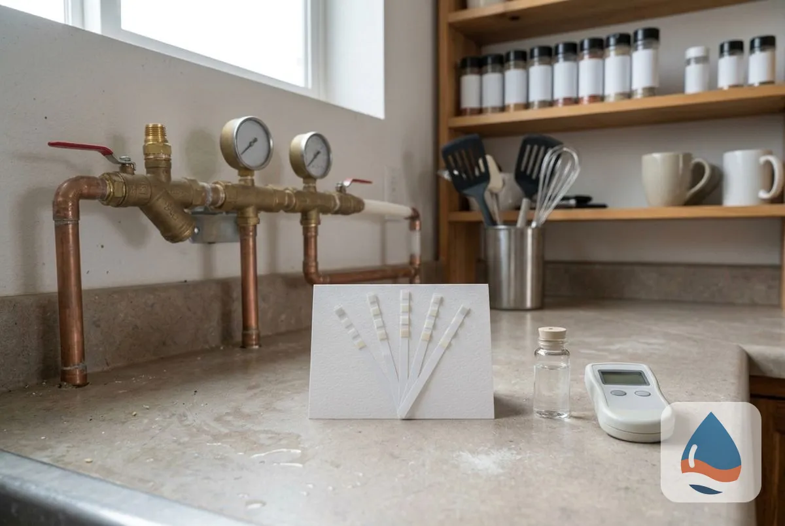
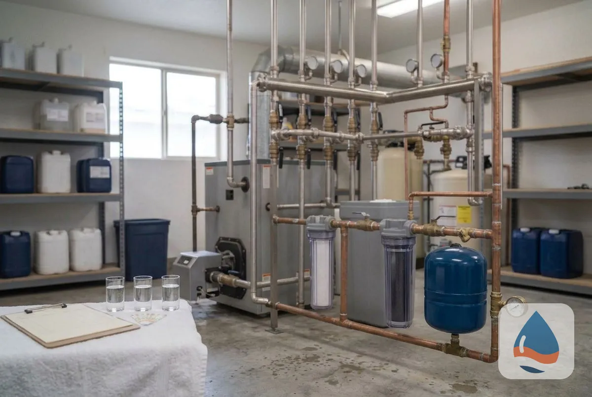
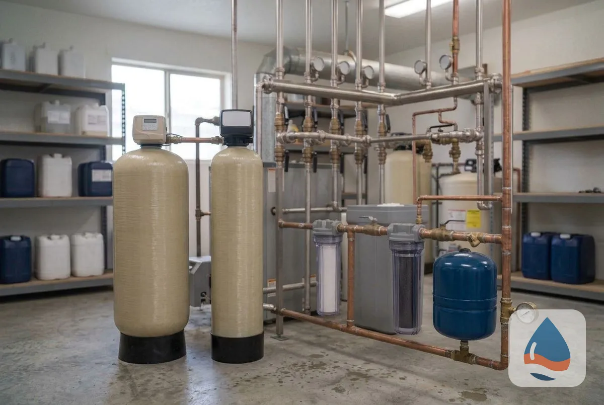
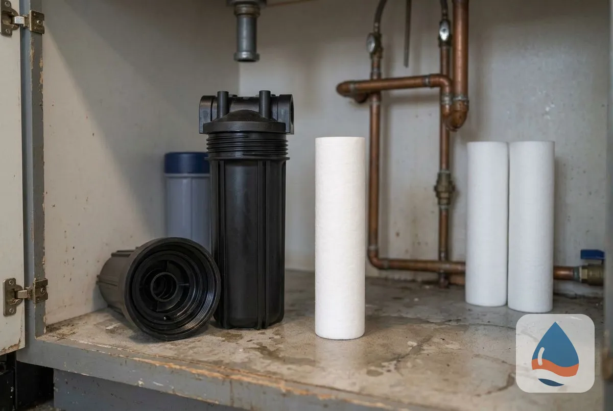
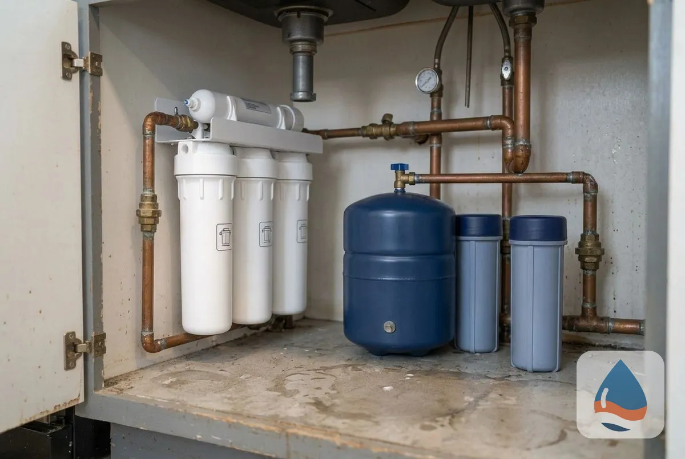
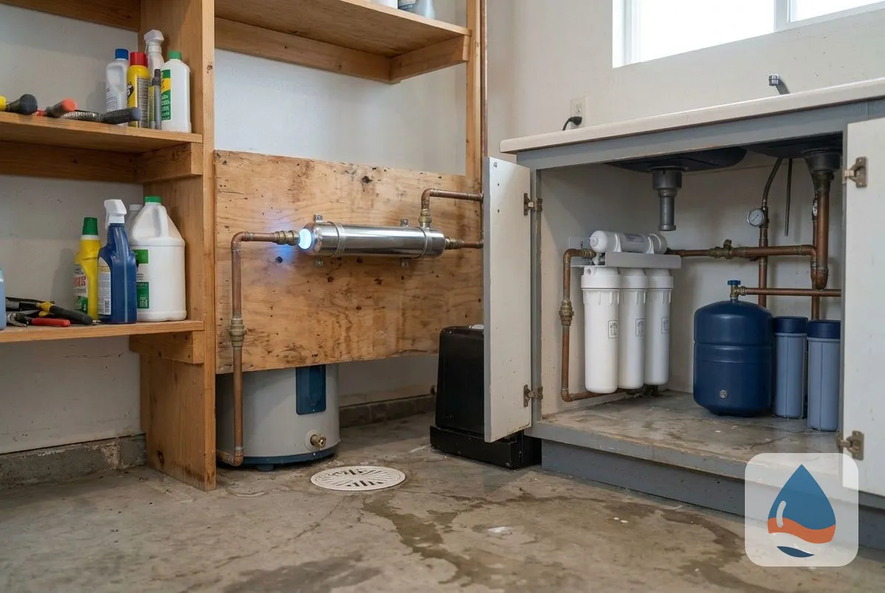
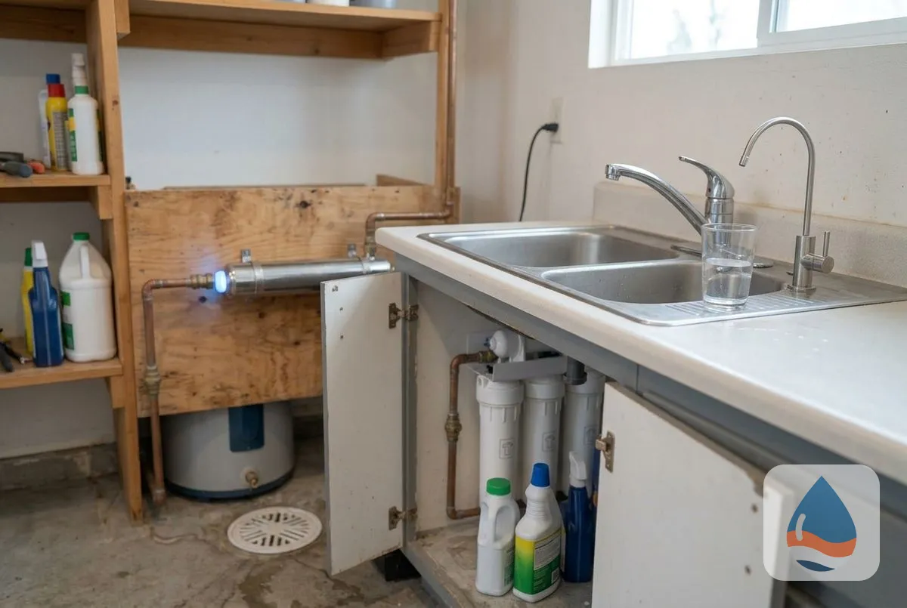

## What Water Treatment Services Are Available in St George, UT?

Water treatment starts with testing and covers filtration, well water treatment, contaminant removal, reverse osmosis, UV purification and drinking water systems.

### Why Test Before You Treat?

A water test shows what is in your water before you buy equipment, so the treatment fits the problem. Hardness is the common one in St George, and your provider's annual report also covers disinfectant and regulated contaminants, but a tap reading shows what reaches your home after your own plumbing.

### Water Quality Testing

A free water test reads hardness, and a fuller test adds total dissolved solids, iron, pH, chlorine, sulfur and metals. Results set the treatment and show whether a softener alone is enough.

### Water Filtration System Installation

A whole-house or point-of-use filter removes sediment, chlorine taste and odor. Filters do not remove hardness minerals, so they pair with a softener where water is hard.

### Well Water Softener and Treatment

Private wells need a test for iron, sulfur and bacteria before a softener goes in. Treating those first protects the resin and gives the softener a clean feed.

### Water Contaminant Removal

Targeted filters reduce specific contaminants such as lead, chloramine, fluoride, PFAS and nitrate. The technician picks the filter from your test result and the contaminant's certification.

### Reverse Osmosis System Installation

A reverse osmosis system filters drinking and cooking water through a fine membrane at one tap. It reduces dissolved solids and many contaminants, and a softener upstream protects the membrane from scale.

### UV Water Purification System Installation

A UV unit disinfects water with ultraviolet light, which suits private wells and homes that want a final safeguard. It treats bacteria and cysts but does not soften water.

### Drinking Water System Installation

Drinking water systems include under-sink filters, countertop units and alkaline systems. The technician matches the system to your taste, budget and test result.

## Which water treatment do you need?

Your test result decides. Start with a free test, then add only the treatment it supports.

## Frequently Asked Questions

Do I need a water test before installing a softener?

Yes. A test gives your hardness in grains per gallon and flags iron or sulfur, so the technician sizes the softener correctly and adds filters where needed.

Does a water softener make water safe to drink?

A softener removes hardness minerals and does not treat bacteria or most contaminants. A filter, reverse osmosis or UV system handles those, based on your test.

Is St George tap water safe to drink?

The City of St. George publishes its results in an annual drinking water quality report. <mark class="data-gap">[NEEDS DATA: compliance statement from the current report.]</mark> A home test shows what reaches your tap after your own plumbing.

What is the difference between filtration and softening?

A filter removes particles and chemicals. A softener removes calcium and magnesium. Many homes need both.

[St George Prime Water Softener UT](/) provides water treatment services for homes and businesses across St George and Washington County.

## Get Your Free Estimate

Request a free water treatment estimate and test. We will contact you within 24 hours. [Get a Free Estimate](#estimate) or return to St George Prime Water Softener for every service we offer.
